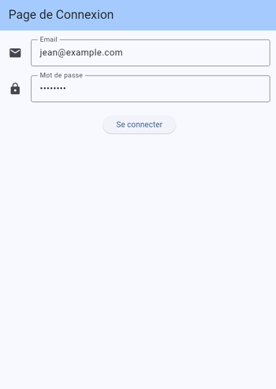
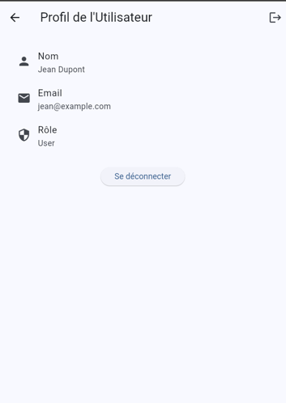
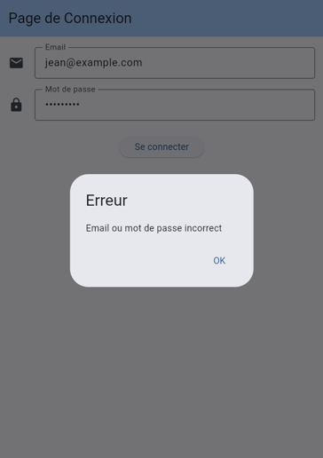
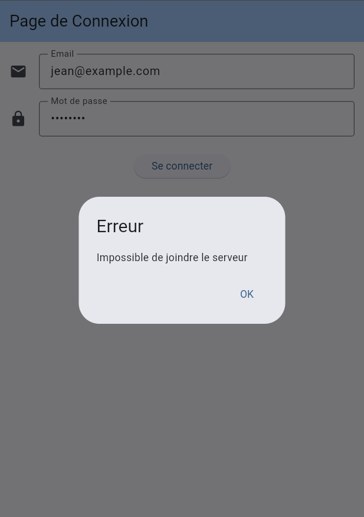

# Application de connexion Flutter avec API REST

Application Flutter de connexion qui authentifie les utilisateurs auprès d'une API REST développée en Node.js. L'application envoie les identifiants en HTTPS, traite la réponse JSON, affiche le profil de l'utilisateur connecté et gère les erreurs.

## Fonctionnalités

**Application Flutter**
- Formulaire de connexion avec validation de l'email et du mot de passe
- Authentification par appel HTTPS à l'API (package `http`)
- Indicateur de chargement pendant la connexion
- Écran de profil : nom, email et rôle
- Messages d'erreur distincts pour les identifiants incorrects et les problèmes techniques (API éteinte, délai dépassé, réponse invalide)
- Affichage adapté aux différentes tailles d'écran

**API Node.js**
- Endpoint `POST /login`, qui accepte le JSON et les formulaires
- Mots de passe stockés hachés avec bcrypt
- Validation des entrées
- HTTPS en local avec un certificat `mkcert`
- CORS limité aux pages servies depuis la machine locale

## Prérequis

- [Flutter](https://docs.flutter.dev/get-started/install) 3.47 ou plus récent
- [Node.js](https://nodejs.org/) 20 ou plus récent
- Google Chrome
- [mkcert](https://github.com/FiloSottile/mkcert), par exemple sous Windows :

  ```
  winget install FiloSottile.mkcert
  ```

  Ouvrez ensuite un nouveau terminal pour que la commande soit reconnue.

## Installation et lancement

### 1. Démarrer l'API

Depuis la racine du projet :

```
cd api
npm install
mkcert -install
npm run cert
npm start
```

`mkcert -install` ajoute une autorité de certification locale à la machine (à faire une seule fois, Windows demande une confirmation). `npm run cert` génère ensuite le certificat dans `api/certs/`. Ces fichiers ne sont pas versionnés.

L'API doit afficher `API démarrée sur https://127.0.0.1:3000`. Laissez ce terminal ouvert.

### 2. Lancer l'application

Dans un second terminal, depuis la racine du projet :

```
flutter pub get
flutter run -d chrome
```

Si Chrome était lancé par Flutter avant `mkcert -install`, relancez-le pour qu'il prenne en compte le certificat.

## Identifiants de test

| Utilisateur | Email | Mot de passe | Rôle |
|---|---|---|---|
| Jean Dupont | `jean@example.com` | `userpass` | User (2) |
| Julie Martin | `julie@example.com` | `adminpass` | Admin (1) |

## API

### `POST /login`

Paramètres : `email` et `password`.

Tester depuis un terminal :

```
curl.exe --ssl-no-revoke -X POST https://127.0.0.1:3000/login -d "email=jean@example.com&password=userpass"
```

L'option `--ssl-no-revoke` est nécessaire sous Windows, car un certificat local ne permet pas de vérifier sa révocation.

Réponse en cas de succès (code HTTP 200) :

```json
{
  "status": 200,
  "message": "Success",
  "id": 1,
  "firstName": "Jean",
  "lastName": "Dupont",
  "email": "jean@example.com",
  "role": 2
}
```

Réponse en cas d'erreur (code HTTP 400) :

```json
{
  "status": 400,
  "message": "Error"
}
```

### Ajouter un utilisateur

Générez le hash du mot de passe, puis ajoutez l'utilisateur dans `api/data/users.json` et redémarrez l'API :

```
npm run hash -- "monMotDePasse"
```

## Sécurité

- Les identifiants circulent en HTTPS.
- Aucun mot de passe n'est stocké en clair : l'API conserve uniquement des hash bcrypt, vérifiés côté serveur.
- La réponse est la même pour un email inconnu et pour un mauvais mot de passe, afin de ne pas révéler quels comptes existent.
- La clé privée du certificat n'est pas versionnée.

## Tests

```
flutter test
```

```
cd api
npm test
```

## Structure du projet

```
├── api/                 API REST Node.js
│   ├── app.js           Routes, validation et gestion des erreurs
│   ├── server.js        Démarrage du serveur HTTPS
│   ├── hash-password.js Génération d'un hash bcrypt
│   ├── data/users.json  Utilisateurs de test
│   └── test/            Tests de l'API
├── lib/
│   ├── main.dart        Point d'entrée de l'application
│   ├── models/          Modèle User
│   ├── screens/         Écrans de connexion et de profil
│   ├── services/        Appels à l'API et adresse du serveur
│   └── widgets/         Composants réutilisables
└── test/                Tests Flutter
```

## Captures d'écran

### Connexion



### Profil



### Identifiants incorrects



### API éteinte



## Vidéo de démonstration

[Voir la vidéo de démonstration](docs/screenshots/Enregistrement%202026-11-04%20160042.mp4)

## Limites connues

- L'API est prévue pour un usage local et n'est pas hébergée en ligne.
- L'application a été testée dans Chrome. Sur un émulateur Android, il faudrait en plus lui faire accepter le certificat local.
